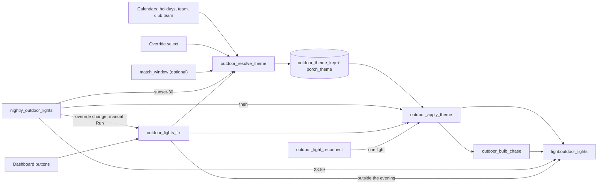
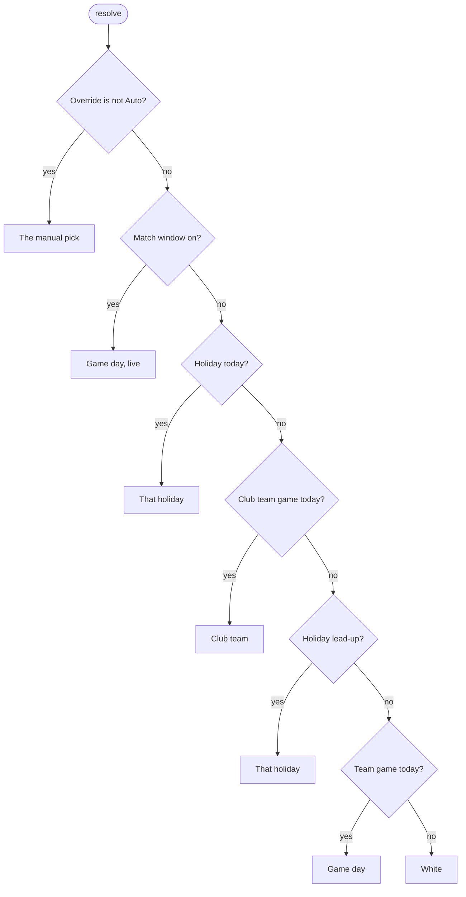

# Home Assistant Holiday Porch Lights


*The badge shows the theme my porch is running tonight (it holds last night's theme during the day).*

## What this is

A how-to for holiday-themed outdoor lights in Home Assistant, built around LIFX. Every evening at dusk the lights come on in the look of the nearest holiday, or in your team's colours on a game day, or plain warm white on an ordinary night. They switch off at 23:59. You can also pick a theme by hand, or paint the house with any LIFX theme or three colours of your own.

This is a cleaned-up, generic version of the setup running on my own porch, not a copy of my live configuration. Entity names are generic and anything specific to my house has been removed. On my porch the game-day look is for STL CITY SC; use whichever team, or none, suits you.

**How it works**

- **One group is the list of lights.** `light.outdoor_lights` is the only place the lights are named. The scripts read its members at run time and sort them by capability: a LIFX multizone strand (its effect list has `effect_move`), colour bulbs (they support `hs`), and white-only lights. To add a light, add it to the group.
- **Resolve, apply, fix.** `outdoor_resolve_theme` decides tonight's theme and touches no lights. `outdoor_apply_theme` drives the lights. `outdoor_lights_fix` does both and is always safe to press.
- **One rules table.** `scripts/outdoor_resolve_theme.yaml` holds a table of `[summary substring, key, lead days, display name]` rows. It is the only place a holiday is defined.
- **Looks live in one theme table.** `scripts/outdoor_apply_theme.yaml` maps each theme key to what the strand and the bulbs do.
- **Survives a missing calendar.** Every calendar lookup continues on error. If one is briefly unavailable the script falls through to the next branch and the lights still come on.
- **Theme name (optional).** The resolve script records the display name of the choice in `input_text.porch_theme`, so a dashboard or a public badge can show what the porch is doing tonight.



**Precedence.** The first line that matches wins.



A holiday lead-up (Christmas starts 25 days out, Halloween 15) keeps its look on an ordinary game night, but the holiday itself and a live match beat it. Between two holidays the rules-table order decides, not the nearest date.

| File | Purpose |
|---|---|
| `packages/holiday_lights.yaml` | Every helper: the light group, theme key, `porch_theme`, override select, paint helpers, match window and goal delay, and the available-lights sensor |
| `scripts/outdoor_resolve_theme.yaml` | The rules table, the calendar lookups, and the theme choice. Writes the key and the name |
| `scripts/outdoor_apply_theme.yaml` | The theme table, the two paint themes, and the code that drives strands, bulbs and white lights |
| `scripts/outdoor_bulb_chase.yaml` | The loop that keeps colour bulbs changing |
| `scripts/outdoor_lights_fix.yaml` | The Fix button: stop, re-pick, then apply or turn off |
| `scripts/goal_celebration.yaml` | Optional goal show for the live match |
| `automations/nightly_outdoor_lights.yaml` | The schedule: sunset-30 on, 23:59 off, restart and dashboard handling |
| `automations/outdoor_light_reconnect.yaml` | Re-applies the theme to a light that comes back |
| `automations/live_match_window.yaml` | Optional: opens a match window and triggers the goal show |
| `dashboards/holiday_lights_view.yaml` | A sections view with the buttons, theme picks and paint controls |

**Entities to replace**

| In this repository | Replace with |
|---|---|
| `calendar.holidays` | Your Holiday integration calendar (for example `calendar.united_states`) |
| `calendar.team_schedule` | Your team's schedule calendar, or delete the game-day pieces |
| `calendar.club_team` | Any second team calendar, found by name. The pattern `(?i)club team` in the resolve script matches the calendar's name; change it to yours, or delete the club team pieces |
| `light.outdoor_lights` | A light group made from your own lights (the package builds one) |
| `light.porch_strand` | Your LIFX multizone strand |
| `light.porch_left`, `light.porch_right`, `light.back_porch` | Your other lights: colour bulbs, or white-only lights |
| `sensor.team_tracker` | The Team Tracker sensor for your team (optional) |
| `input_boolean.match_window`, `input_number.goal_delay` | Created by the package (optional, live match only) |
| `input_text.porch_theme` | Created by the package (optional) |

Theme white uses fixed values, `white_kelvin: 2700` and `white_brightness: 255`, at the top of the apply script's variables. Point them at your own sensors if you run circadian lighting.

## Install

**Requirements:** Home Assistant 2024.10 or later, the core Holiday and LIFX integrations, and at least one LIFX light. The Sun integration is on by default. The dashboard view needs [Mushroom](https://github.com/piitaya/lovelace-mushroom) from HACS. The live match is optional and needs the [Team Tracker](https://github.com/vasqued2/ha-teamtracker) integration from HACS.

1. **Holiday calendar.** Settings > Devices & services > Add integration > Holiday, pick your country and region. Note the calendar entity it creates and use it in place of `calendar.holidays`. If a holiday you want (Halloween, Valentine's Day, St. Patrick's Day) is missing, check the integration's options for extra holiday categories.
2. **Team calendar (optional).** Add your team's schedule as a calendar, for example with the Remote Calendar integration and the ICS link the league publishes. Use its entity in place of `calendar.team_schedule`. Keep the same entity id from year to year by editing the URL in place: deleting and re-adding the calendar can give it a new id. In `scripts/outdoor_resolve_theme.yaml`, change `'my team'` in `is_game_day` to a lowercase part of your team's name as it appears in event titles.
3. **Helpers.** Enable packages if you have not already, by adding this to `configuration.yaml`:
   ```yaml
   homeassistant:
     packages: !include_dir_named packages
   ```
   Copy `packages/holiday_lights.yaml` to `/config/packages/`, swap the four lights in the group for your own, and restart. Or build the group in the UI (Settings > Devices & services > Helpers > Group > Light group, named `Outdoor lights`) and delete the `light:` block from the package.
4. **Scripts.** For each file in `scripts/`: Settings > Automations & scenes > Scripts > Add script > three-dot menu > Edit in YAML, paste it, adjust the entities, save. Each script's entity id comes from its name, so keep the names. Start with `outdoor_bulb_chase`, `outdoor_apply_theme` and `outdoor_resolve_theme`, then `outdoor_lights_fix`. Skip `goal_celebration` unless you want the live match.
5. **Automations.** Settings > Automations & scenes > Create automation > three-dot menu > Edit in YAML. Paste `nightly_outdoor_lights.yaml`, then `outdoor_light_reconnect.yaml`, and `live_match_window.yaml` if you want it, and save each.
6. **Dashboard.** Install Mushroom, then paste `dashboards/holiday_lights_view.yaml` into a dashboard as a view (the file explains how).
7. **Try it.** Press Fix on the dashboard, or run the nightly automation by hand. Check Settings > Automations & scenes > Scripts > Outdoor Resolve Theme > Traces to see which branch it took.

**Adding a theme.** Look up the exact event summary the calendar uses (Developer tools > Actions > `calendar.get_events`), then:

1. Add a row to `rules` in the resolve script with a distinctive substring of it. Put rows with a long lead-up above rows with a short one.
2. Add an entry under `themes` in the apply script. A strand entry is either `mode: move` with a built-in LIFX theme name, or `mode: blocks` with a list of `[hue, saturation]` colours. A bulb entry is `mode: chase` with its own colour list and an interval in seconds.
3. If you want a manual button, add an option to `input_select.outdoor_theme_override` and to the option map in the resolve script.

**Adding a light.** Add it to `light.outdoor_lights`. Nothing else changes.

## Paint the house

Pick a LIFX theme from the paint select and press Paint, or set three hues and press Paint my colours. Both set the override, so they run at once, even in daylight, and last until 23:59.

- **Paint a LIFX theme.** The strand runs the theme with `lifx.effect_move`. At speed 0 it paints the theme and holds it still. The bulbs repaint from the same theme every 5 seconds.
- **Paint my colours.** The three hues become blocks of four zones each, repeating along the strand. At speed above 0 the blocks scroll. The bulbs rotate through the three colours every 20 seconds.
- **Speed.** The slider is seconds for the pattern to cross the whole strand. 0 is still and 60 is the most the strand accepts.
- Changing a paint setting while the override is not Auto re-paints. While it is Auto, the change waits until you press Paint.
- LIFX themes carry their own brightness for each colour, so theme-driven bulbs and strand zones vary in brightness by design.

## The Fix button

`script.outdoor_lights_fix` is the one button for "something looks wrong". It stops the bulb loop, runs the resolve script again, then either applies the theme or turns everything off:

- It applies the theme if it is between sunset-30 and 23:59, or if you pressed Turn on now, or if a manual pick is set.
- Otherwise it stops any strand effect and turns the group off.

Pressing Run on the nightly automation does the same thing, because a manual run has no trigger and falls to the automation's default branch. Use it after a power blip, a strand re-calibration, a stuck colour loop, or a calendar change.

## Live match (optional)

`automations/live_match_window.yaml` uses the Team Tracker sensor to open `input_boolean.match_window` from two hours before kickoff to 15 minutes after full time. While it is on, the game-day look wins over everything except a manual pick. Fix runs at each edge. There is a five hour safety switch-off, and a restart reconciles the window.

When your team scores and the lights are on, `script.goal_celebration` waits `input_number.goal_delay` seconds (broadcast lag), runs ten seconds of fireworks on the strand and a colour loop on the bulbs, flashes the team colours once per goal, and re-applies the theme. The colours in it are an example: edit the hues for your team.

## The gotchas

**Calendar.** Three things went wrong when I moved to the core Holiday calendar, and each has a quiet failure mode.

1. **Core calendar entities have no `events` attribute.** `state_attr('calendar.holidays', 'events')` returns nothing, so a find-and-replace of an old calendar entity id fails silently and every night falls through to the default. The events have to be fetched with the `calendar.get_events` action into a `response_variable`.
2. **`duration:` counts from now.** With `duration:` the window starts at the current moment and returns an empty list whenever the next holiday is farther out than the window. The script uses an explicit `start_date_time` of today at 00:00 and an `end_date_time` 25 days later (the longest lead, for Christmas). Anchoring to the start of today also makes the day-of check reliable whatever time the script runs.
3. **Holiday summaries are messy, so match by substring.** Martin Luther King Jr. Day arrives as one combined string (`Birthday of Martin Luther King, Jr.; Martin Luther King Jr. Day`, matched with `King`). Presidents Day is `Washington's Birthday`. Independence Day appears twice, including `Independence Day (observed)`. The calendar also carries many holidays with no theme (Christmas Eve, New Year's Eve, Good Friday, Groundhog Day, state holidays) that the substring list ignores by design. Never compare with `==`.

One more shape to know: `calendar.get_events` returns `start` as a plain ISO string (`"2026-09-07"` for an all-day event), not a dict. The script reads the first ten characters and does date-only maths, which avoids the naive-versus-aware datetime error you get from comparing an all-day event with `now()`.

**LIFX.**

1. **A custom palette in `paint_theme` blends hues.** Painting red, green and blue gives you every colour in between on the strand. For exact colours the apply script paints zone blocks with `lifx.set_state` and a zone list.
2. **`effect_move` only paints when given a theme.** Called with no theme it scrolls whatever colours are already on the zones. That is how custom colours move: paint the blocks first, then call a bare `effect_move`.
3. **`effect_move` speed is seconds for the whole strand.** It is not a rate, and 60 is the maximum.
4. **Holding the strand's button for two seconds wipes the effect.** That re-learns the zones, and Home Assistant sees no event for it. The strand just goes plain. Press Fix.
5. **LIFX themes carry their own brightness.** Theme-driven bulbs and strand zones differ in brightness by design. `effect_move` has no brightness field, so the apply script sets the strand to full brightness first.

**Tuning.** Lead days, colours and display names live in `rules` and `themes`. The start (30 minutes before sunset) and end (23:59) times live in the nightly automation. To end the evening at a different time, change the `time` trigger and the matching `before:` conditions in the nightly automation, the Fix script and the reconnect automation.

## Publish live values (optional)

The resolve script writes the theme name (for example `Halloween`, `Game day`, or `White`) to `input_text.porch_theme`, and it keeps that value until the next evening. That makes it publishable as a live badge, the same way the circadian-lights how-to publishes its sensors: see "Publish live values" in [HA_circadian_lights](https://github.com/mels0n/HA_circadian_lights) for the small read-only proxy. Add `input_text.porch_theme` to the proxy's `$entities` allow-list, then point a shields.io [dynamic JSON badge](https://shields.io/badges/dynamic-json-badge) at it with a query like `$['input_text.porch_theme']`.

The proxy only ever reads the entity ids on its allow-list and only returns their `state`, so a caller cannot use it to read anything else.

## Secrets

Nothing in this repository needs credentials. If you set up the optional proxy, it needs a Home Assistant long-lived access token, covered in the circadian-lights how-to linked above. Never commit a token, and keep calendar ICS links out of public repositories too: some leagues publish per-user links.

## License

MIT. See [LICENSE](LICENSE).
